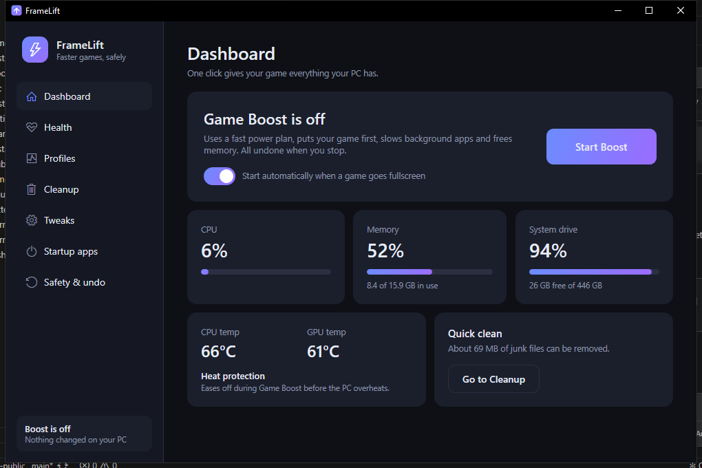
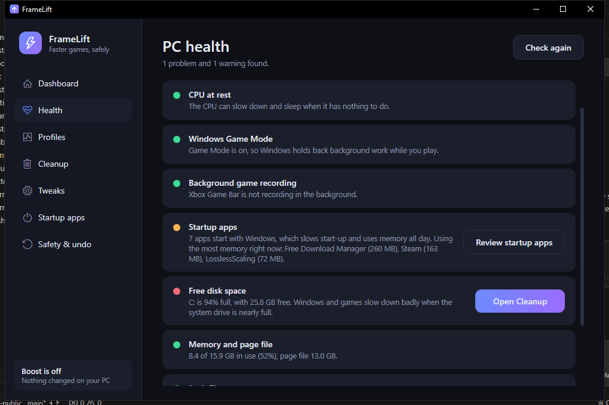
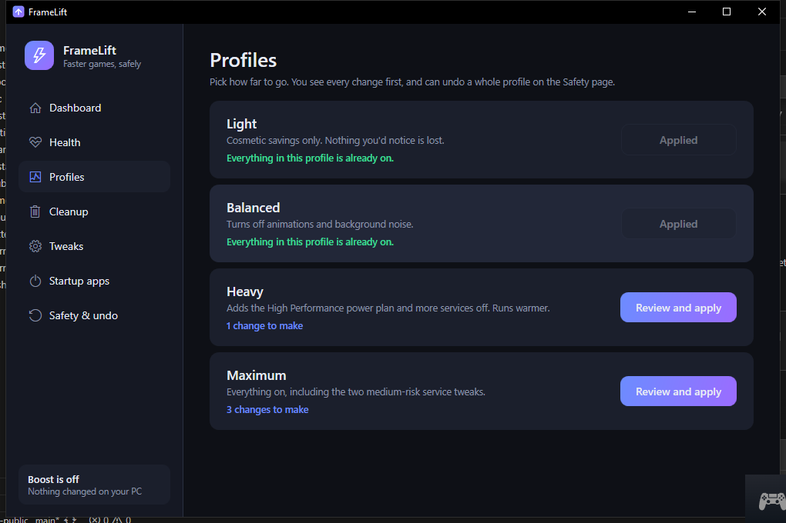
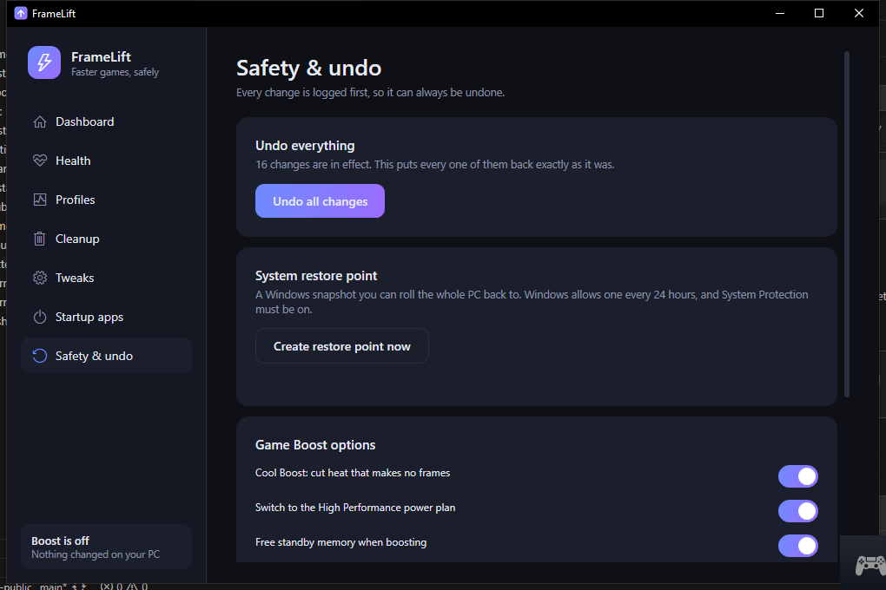

<p align="center"></p>

# FrameLift

**Faster games on weaker PCs.** One-click Game Boost, heat protection, a PC health check and full undo, in one
Windows tray app.



| | |
|---|---|
|  |  |
|  | |

## What it does

| Feature | What you get |
|---|---|
| **Game Boost** | Starts by itself when a game goes fullscreen (or with one click). Switches to a performance power plan, raises the game's priority, slows background apps, and frees standby memory again when it fills up. Everything goes back when the game ends. |
| **Cool Boost** | Part of Game Boost: cuts heat that makes no frames. Lets the CPU clock down and sleep between frames instead of idling at full turbo, makes turbo kick in only when the game needs it, asks for the fan before throttling, and trims the GPU's hottest clocks where the driver allows it. A plan whose hidden low maximum was masked by a 100 % minimum keeps its real top speed. |
| **Heat protection** | While Boost is on, it holds the CPU near a target temperature (88 °C by default) with small steps instead of swinging between full speed and a hard cap. The first step only turns turbo off. If it ever reaches the critical level it cuts hard, then climbs back to one step below the speed that overheated, so the overheat does not repeat. It only ever lowers a limit, and puts everything back when Boost stops. |
| **PC health check** | One page showing what slows the PC down: power plan, a CPU that never rests (full speed while idle), Game Mode, background game recording, startup apps, disk space, memory and page file, junk files and temperature. Each finding has a one-click fix where one exists. |
| **Profiles** | Light, Balanced, Heavy and Maximum bundles of tweaks. You see every change before it is made. |
| **Cleanup, Tweaks, Startup apps** | Delete junk files, flip individual Windows tweaks, and turn startup apps off without uninstalling them. |
| **Tray** | Open, start or stop Boost, quit. Closing the window hides it to the tray. Can start with Windows. |

## Safe by design

1. Every change is written to a journal (`%ProgramData%\FrameLift\journal.json`) **before** it is made, with what it was before.
2. **Undo all changes** puts everything back exactly as it was. Single tweaks can be switched off one by one.
3. A watchdog (a second copy of the exe) waits for the app to exit, even if it crashes or is killed, and undoes whatever Game Boost left behind.
4. Anything FrameLift is unsure about it skips: protected system and anti-cheat processes are never touched, and no temperature reading means no limit is applied.
5. It can create a Windows restore point before the first change.

## Requirements
- Windows 10 or 11, x64. The exe asks for administrator rights, because it changes power plans and services.
- CPU temperature comes from LibreHardwareMonitor. If the CPU shows `--`, try `winget install namazso.PawnIO`.
- GPU temperature works through the same library, with `nvidia-smi` as a fallback on NVIDIA cards.

## Install
Download the zip from [Releases](../../releases), then in an elevated PowerShell:

```powershell
.\install.ps1              # copies to C:\Program Files\FrameLift and adds a Start Menu shortcut
.\install.ps1 -Autostart   # also starts it hidden in the tray at sign-in (no UAC prompt)
.\install.ps1 -Uninstall   # removes it. Use "Undo all changes" first if you want tweaks reverted
```
Settings live in `%AppData%\FrameLift` and are kept on uninstall.

## Build from source
Needs the .NET 8 SDK.

```powershell
dotnet build
dotnet test           # unit tests, no hardware needed
.\publish.ps1         # builds the self-contained dist\FrameLift.exe
```
Layout: `src/FrameLift/Core` (engines: journal, tweaks, boost, heat guard, health, cleanup), `src/FrameLift` (WPF window and tray), `tests/FrameLift.Tests`.

## How this relates to ThermalGuard and StutterFix
FrameLift grows out of two earlier tools of mine, and brings their useful parts into one app with one tray icon, one journal and one undo:

| Earlier project | What FrameLift took from it |
|---|---|
| [**ThermalGuard**](https://github.com/NotKazuma/ThermalGuard) | Temperature sensors and the heat protection: lower the CPU cap and GPU power limit as it gets hot, crash-safe restore. |
| [**StutterFix**](https://github.com/NotKazuma/StutterFix) | Game priority, quieting background apps, and the standby memory cleaner. |

What is new in FrameLift: the health check, profiles, cleanup, tweaks, startup manager, and the single shared undo journal.
What was left behind: ThermalGuard's FPS overlay and AMD GPU control, and StutterFix's frame-time meter and timer-resolution request.

ThermalGuard and StutterFix keep working on their own. Run **one** of them or FrameLift, not several at once: FrameLift's heat protection
stands down automatically while the ThermalGuard app is running, so two limiters never fight over the same power setting.

## Known limits
- **It does not cool your PC.** Heat protection stops a throttle or shutdown; sustained high temperatures in games point to dust, dried thermal paste or a weak fan, which software cannot fix.
- GPU power and clock limits work only on NVIDIA cards that allow them. Many laptop GPUs (the GTX 1060 it was tested on included) refuse both, and then FrameLift simply skips them; heat protection then works through the CPU alone.
- Tested on one machine so far (an i7-6700HQ / GTX 1060 laptop on Windows 10). Not yet tested on AMD, on desktops, or across a long run of real game sessions.
- The exe is unsigned, so SmartScreen will warn. The hardware-monitor driver can be flagged by some antivirus tools, and some anti-cheat systems object to it.

## License
[MIT](LICENSE). Third-party components are listed in [THIRD-PARTY-NOTICES.md](THIRD-PARTY-NOTICES.md).
